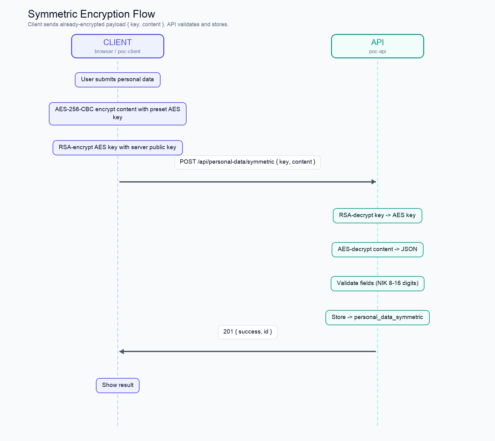
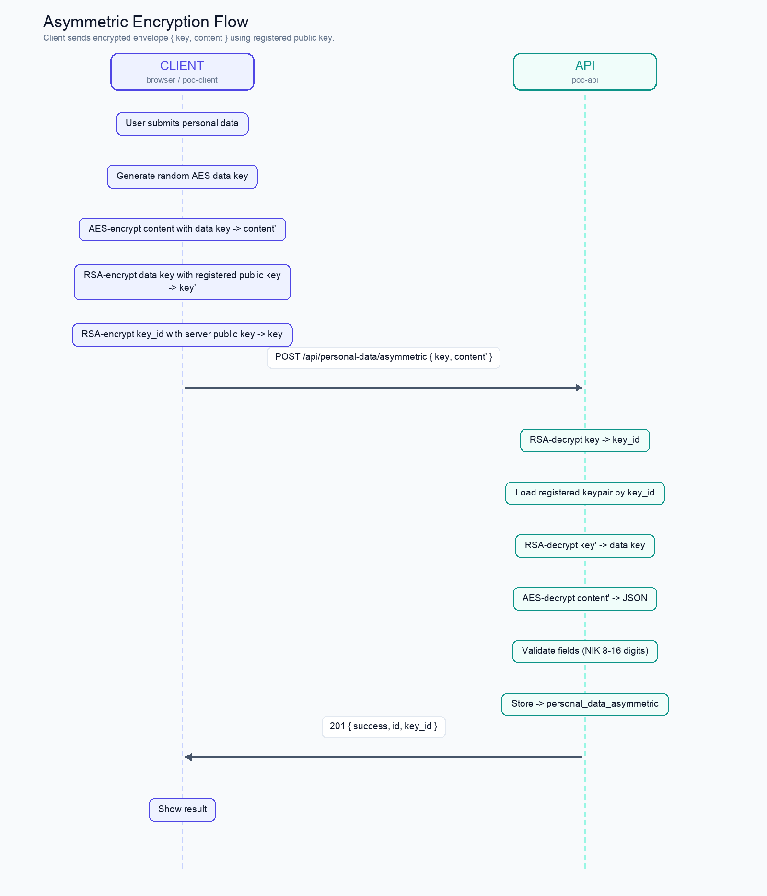

# Encryption POC (poc-api + poc-client)

Simulasi **symmetric** dan **asymmetric encryption** untuk data personal. Client **menyimpan key** dan mengirim payload terenkripsi `{ "key", "content" }` ke API; API memvalidasi/dekripsi dan mengelola data ke migrasi `personal_data_symmetric` & `personal_data_asymmetric`.

## Struktur
- `poc-api/` — Laravel API: endpoint crypto & personal-data, Swagger, penyimpanan key terdaftar di `storage/app/keys`.
- `poc-client/` — Laravel client (web UI): key preset dari awal project; UI hanya submit data, enkripsi payload dilakukan otomatis sebelum kirim ke API.

## Alur ringkas
1. **Transport**: client ambil server public key (`GET /api/crypto/server-public-key`) untuk mengenkripsi field `key` (dan identitas key) saat dikirim.
2. **Symmetric**: client memakai AES-256 key **preset** dari config → enkripsi JSON konten (AES-256-CBC) & enkripsi `key` (RSA server) → `POST /api/personal-data/symmetric` `{key,content}` → API dekripsi, validasi, simpan ke `personal_data_symmetric`.
3. **Asymmetric**: client memakai keypair **preset** (public key terdaftar di API, `key_id=preset-demo`) → bungkus konten (AES data-key + data-key dienkripsi RSA public key) & kirim `key_id` terenkripsi → `POST /api/personal-data/asymmetric` → API dekripsi/validasi, simpan ke `personal_data_asymmetric`.
4. Public key asimetris terdaftar disimpan di DB `registered_keys` dan file `poc-api/storage/app/keys/registered/` (demo mode: gitignore keys dilonggarkan).

## Diagram alur

### Symmetric
Client mengenkripsi `content` dengan AES preset, lalu `key` (AES key) dengan RSA server. API mendekripsi, memvalidasi, dan menyimpan ke `personal_data_symmetric`.



### Asymmetric
Client membungkus `content` dengan hybrid AES + public key terdaftar, lalu mengirim `key` (`key_id`) terenkripsi RSA server. API mendekripsi, memvalidasi, dan menyimpan ke `personal_data_asymmetric`.



## Menjalankan
```bash
# API
cd poc-api
cp .env.example .env && php artisan key:generate
touch database/database.sqlite && php artisan migrate
php artisan serve --port=8001

# Client (terminal lain)
cd poc-client
cp .env.example .env && php artisan key:generate
# pastikan ENCRYPTION_API_URL=http://127.0.0.1:8001
php artisan serve --port=8002
```
- Swagger UI: `http://127.0.0.1:8001/api/documentation` (generate: `php artisan l5-swagger:generate`)
- Client UI: `http://127.0.0.1:8002`

## Catatan
`shortcut:` demo menyimpan private key terdaftar di server untuk simulasi dekripsi & transport key sederhana; produksi wajib pemisahan kunci, proteksi private key, manajemen/rotasi key, dan auth/HTTPS.
